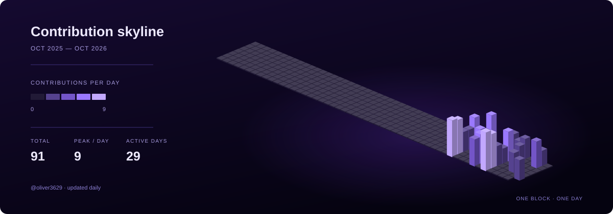

# Hi 👋, I'm Oliver

### MSCS @ Pitt

- 👯 I'm looking to collaborate on **backend systems and networking research**
- 💬 Ask me about **Java, Spring Boot, Kotlin, React, and Linux networking (TCP/BBR)**
- ⚡ Fun fact: **I co-authored an ACM IMC 2026 paper on accelerating BBR startup.**

 

